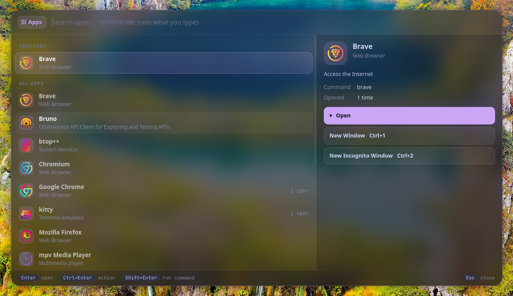

<p align="center">
  <picture>
    <source media="(prefers-color-scheme: dark)" srcset="assets/banner-dark.svg">
    <source media="(prefers-color-scheme: light)" srcset="assets/banner-light.svg">
    
  </picture>
</p>

<p align="center">
  <b>App launcher: your most-used apps first, app actions, running windows, run a command.</b><br>
  The app launcher. A tool for <a href="https://github.com/Theyashsawarkar/vyom">Vyom</a>, keyboard-driven panels for Wayland.
</p>

<p align="center">
  <a href="https://github.com/Theyashsawarkar/dvara/actions/workflows/ci.yml"></a>
  <a href="https://github.com/Theyashsawarkar/dvara/releases"></a>
  <a href="LICENSE"></a>
  <a href="https://github.com/Theyashsawarkar/vyom"></a>
  
  
</p>

<p align="center">
  
</p>

> *Dvara* (द्वार) is Sanskrit for "gateway": the doorway every app is opened through.

dvara is the app launcher for [Vyom](https://github.com/Theyashsawarkar/vyom): one keyboard-driven panel that opens instantly, with live data, a preview and a key for everything. It runs on any compositor with the layer-shell protocol (sway, Hyprland, river, niri, Wayfire, labwc…). In [Vayu](https://github.com/Theyashsawarkar/vayu), the desktop it was built for, it replaces wofi's app launcher (`wofi --show drun`).

## Contents

- [Features](#features)
- [Install](#install)
- [Usage](#usage)
- [Configuration](#configuration)
- [Troubleshooting](#troubleshooting)
- [The Vyom family](#the-vyom-family)
- [Contributing](#contributing)
- [License](#license)

## Features

- Every installed app (.desktop files), with its real icon.
- Ranked by **how often and how recently you open each app**; with an empty search, your frequent apps come first, then everything A–Z.
- Matches the name, the generic name ("Web browser"), keywords and the command, typos and all.
- The preview shows what the app is, **how many of its windows are already open**, and its own actions (New window, Private window…), each on `Ctrl+1..9`.
- `Shift+Enter` runs whatever you typed as a command in a terminal; a row below the results runs it without one.
- Keyboard first: every action has a key, shown in the footer; the mouse works too.
- Never freezes the panel: slow commands run in the background.

## Install

### Requirements

- [Vyom](https://github.com/Theyashsawarkar/vyom) 0.2.5 or newer (Python 3.11+, PyGObject, GTK 4, [gtk4-layer-shell](https://github.com/wmww/gtk4-layer-shell), a Nerd Font)
- optional: swaymsg (open-window counts)

### Install

```sh
git clone https://github.com/Theyashsawarkar/dvara ~/.local/share/vyom/plugins/dvara
vyom reload           # pick it up (or log out and in)
vyom dvara            # open it; run it again to close
```

Give it a key in your compositor, e.g. sway:

```sh
bindsym $mod+<key> exec vyom dvara
```

### Update and uninstall

```sh
git -C ~/.local/share/vyom/plugins/dvara pull && vyom reload     # update
rm -rf ~/.local/share/vyom/plugins/dvara && vyom reload          # uninstall
```

## Usage

Open it with `vyom dvara` (or your key). Type to search; the footer always shows the keys for what's selected.

| Key | Action |
|---|---|
| `Enter` | Open the selected app |
| `Ctrl+Enter` | Run the selected app's first action (e.g. a new window) |
| `Shift+Enter` | Run what you typed as a command (in a terminal) |
| `Ctrl+1..9` | Run that numbered action of the selected app |
| `Esc` | Close the panel |

Every Vyom panel also has `Up`/`Down` (or `Ctrl+K`/`Ctrl+J`) to move, `Page Up`/`Page Down` to jump and `Tab` to switch to the next tool.

## Configuration

Everything is optional, in `~/.config/vyom/config.toml` under `[plugin.dvara]`:

| Setting | Default | What it does |
|---|---|---|
| `terminal` | $TERMINAL, else kitty/foot/alacritty/wezterm | Terminal for Shift+Enter |

Run `vyom reload` after editing.

## Troubleshooting

- **Nothing opens.** `vyom list` shows every installed tool, and why one is skipped (a missing requirement, or a Vyom that's too old).
- **It opened, then something failed.** Look for a `Traceback` in `~/.local/state/vyom/daemon.log`, and [open an issue](https://github.com/Theyashsawarkar/dvara/issues/new/choose) with it.
- **No blur or rounded corners.** That's the compositor: on SwayFX, add `layer_effects "vyom" { blur enable; corner_radius 20; shadows enable }`.

## The Vyom family

Each tool is its own repository, so you install only the ones you want:

| Tool | | What it does |
|---|---|---|
| [dvara](https://github.com/Theyashsawarkar/dvara) (this one) | द्वार, gateway | The app launcher |
| [ganit](https://github.com/Theyashsawarkar/ganit) | गणित, mathematics | The calculator and converter |
| [smriti](https://github.com/Theyashsawarkar/smriti) | स्मृति, memory | Clipboard history |
| [bhava](https://github.com/Theyashsawarkar/bhava) | भाव, feeling, emotion | The emoji picker |
| [tarang](https://github.com/Theyashsawarkar/tarang) | तरंग, wave | Wi‑Fi and the hotspot |
| [setu](https://github.com/Theyashsawarkar/setu) | सेतु, bridge | Bluetooth |
| [doot](https://github.com/Theyashsawarkar/doot) | दूत, messenger | Your phone, through KDE Connect |
| [patra](https://github.com/Theyashsawarkar/patra) | पात्र, vessel | Docker containers |
| [suchana](https://github.com/Theyashsawarkar/suchana) | सूचना, notice | Notifications |
| [raga](https://github.com/Theyashsawarkar/raga) | राग, melody | YouTube music and video |
| [mudra](https://github.com/Theyashsawarkar/mudra) | मुद्रा, gesture | Keybinding search |
| [urja](https://github.com/Theyashsawarkar/urja) | ऊर्जा, energy | The battery at a glance |
| [vishram](https://github.com/Theyashsawarkar/vishram) | विश्राम, rest | The power menu |
| [kendra](https://github.com/Theyashsawarkar/kendra) | केन्द्र, centre | Quick settings |

## Contributing

Bug reports, ideas and pull requests are welcome: see [CONTRIBUTING.md](CONTRIBUTING.md) for the development setup and the few rules every tool follows, and [CHANGELOG.md](CHANGELOG.md) for what changed in each release. Please report security issues privately ([SECURITY.md](SECURITY.md)).

## License

[MIT](LICENSE).
